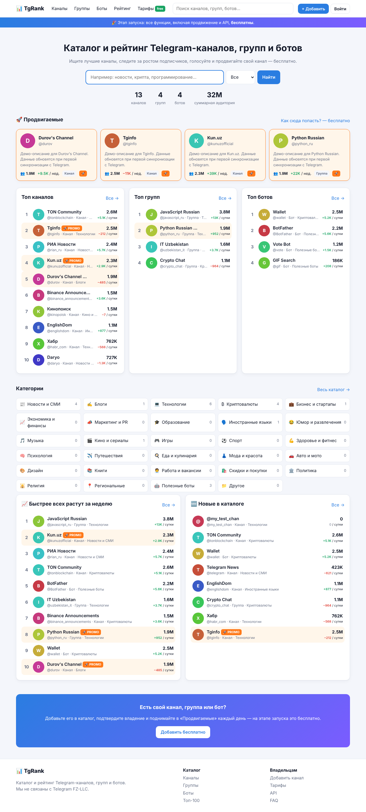

# TgRank — каталог и рейтинг Telegram-каналов, групп и ботов

Этап 1: **все функции бесплатны** (флаг `FREE_MODE=true`), включая продвижение и API.



## Функции

**Каталог и поиск**
- Каналы, группы и боты; 29 категорий (редактируются в админке); 9 языков
- Поиск по названию, @username, описанию и тегам
- Фильтры: тип, категория, язык, диапазон подписчиков, «подтверждённый владелец»
- Сортировки: популярные, подписчики, рост за сутки/неделю/месяц, голоса, рейтинг отзывов, новые, просмотры

**Рейтинги (Топ-100)** — по подписчикам, росту за сутки/неделю/месяц, голосам и отзывам; отдельно для каналов, групп и ботов, с фильтром по категории и языку.

**Страница канала** — аватар, описание, теги, подписчики, прирост, место в рейтинге, интерактивный график за 90 дней, отзывы с оценкой 1–5, голосование (раз в сутки), избранное, «Поделиться», жалоба, похожие каналы.

**Данные из Telegram** — при добавлении и каждые `STATS_INTERVAL_HOURS` часов название, описание, аватар и подписчики берутся с публичной страницы `t.me/<username>`. С `TELEGRAM_BOT_TOKEN` число подписчиков берётся точно через Bot API. История пишется по дням.

**Владельцам**
- Бесплатное добавление (через модерацию)
- Подтверждение владения: персональный код в описании канала
- 🚀 Продвижение: блок «Продвигаемые» на главной + верх каталога на 24 ч, раз в сутки (бесплатно)
- Настройки карточки (категория, язык, теги), удаление, бейдж «Мы в рейтинге»

**Пользователи** — регистрация по email или «Войти через Telegram», личный кабинет (мои каналы, статусы модерации, избранное).

**Админка** (`/admin`) — модерация (одобрить/отклонить с причиной), смена категории, закрепление, снятие буста, сброс владельца, ручное обновление данных, удаление; пользователи (бан, роли); категории; жалобы; отзывы; запуск обновления статистики.

**Прочее** — открытый JSON API (`/api-docs`), страница тарифов (сейчас всё 0 ₽, будущие цены зачёркнуты), FAQ, `sitemap.xml`, `robots.txt`, тёмная тема, адаптив под телефон, защита от CSRF.

## Запуск

Нужен Node.js 22.5+ (используется встроенный SQLite, отдельная БД не нужна).

```bash
npm install
cp .env.example .env   # заполните
npm run seed           # категории; `npm run seed -- --demo` — ещё и демо-каналы
node --env-file=.env --no-warnings server.js
```

Откройте http://localhost:3000 и зарегистрируйтесь с `ADMIN_EMAIL` — получите доступ к `/admin`.

### Docker

```bash
docker build -t tgrank .
docker run -d -p 3000:3000 --env-file .env -v tgrank-data:/app/data tgrank
```

## Когда включать платные функции

1. Подключите платёжку (ЮKassa, Payme/Click, Telegram Stars) и обработчик оплаты, который выставляет каналу `boost_until`.
2. Поставьте `FREE_MODE=false`: кнопка бесплатного продвижения отключится, на `/pricing` появятся цены.

## Структура

```
server.js              — Express, сессии, CSRF, маршруты, планировщик обновлений
src/db.js              — схема SQLite
src/telegram.js        — парсинг t.me, Bot API, проверка входа через Telegram
src/channels.js        — запросы каталога, рейтинги, рост
src/stats.js           — фоновое обновление подписчиков
src/routes/            — public, auth, account, admin, api
views/                 — шаблоны EJS
public/                — CSS и JS (график без библиотек)
```
